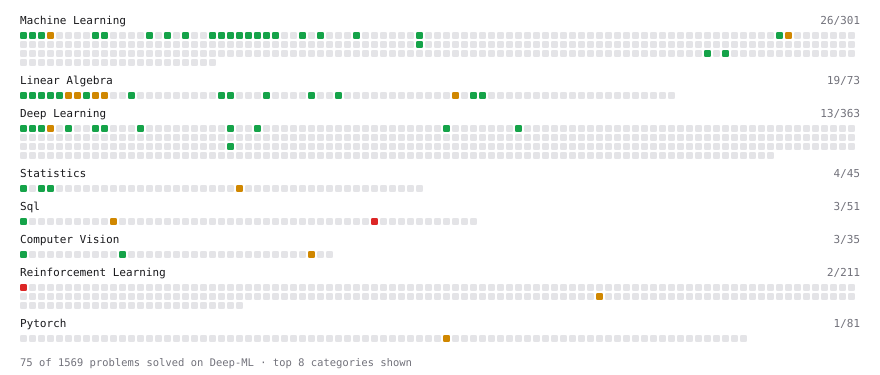

# Deep-ML

My machine learning practice from [Deep-ML](https://www.deep-ml.com). Every solution here was written by hand.

**89** solved · 79 problems · 0 labs · 10 math

[**Browse the interactive portfolio**](https://ashml.github.io/deep-ml/) to replay this filling in over time.

## Problems

| | Difficulty | Solved | |
| --- | --- | --- | --- |
| [Balance Dataset via Undersampling](https://www.deep-ml.com/problems/1057) | easy | 2026-10-14 | [solution](problems/1057-balance-dataset-via-undersampling) |
| [Batch Iterator for Dataset](https://www.deep-ml.com/problems/30) | easy | 2026-04-17 | [solution](problems/0030-batch-iterator-for-dataset) |
| [Bhattacharyya Distance Between Two Distributions](https://www.deep-ml.com/problems/120) | easy | 2026-05-29 | [solution](problems/0120-bhattacharyya-distance-between-two-distributions) |
| [Calculate 2x2 Matrix Inverse](https://www.deep-ml.com/problems/8) | easy | 2026-03-19 | [solution](problems/0008-calculate-2x2-matrix-inverse) |
| [Calculate Accuracy Score](https://www.deep-ml.com/problems/36) | easy | 2026-09-09 | [solution](problems/0036-calculate-accuracy-score) |
| [Calculate Cosine Similarity Between Vectors](https://www.deep-ml.com/problems/76) | easy | 2026-10-16 | [solution](problems/0076-calculate-cosine-similarity-between-vectors) |
| [Calculate Covariance Matrix](https://www.deep-ml.com/problems/10) | easy | 2026-04-04 | [solution](problems/0010-calculate-covariance-matrix) |
| [Calculate Dice Score for Classification](https://www.deep-ml.com/problems/73) | easy | 2026-09-18 | [solution](problems/0073-calculate-dice-score-for-classification) |
| [Calculate F1 Score from Predicted and True Labels](https://www.deep-ml.com/problems/91) | easy | 2026-05-28 | [solution](problems/0091-calculate-f1-score-from-predicted-and-true-labels) |
| [Calculate Image Brightness](https://www.deep-ml.com/problems/70) | easy | 2026-08-02 | [solution](problems/0070-calculate-image-brightness) |
| [Calculate Jaccard Index for Binary Classification](https://www.deep-ml.com/problems/72) | easy | 2026-09-18 | [solution](problems/0072-calculate-jaccard-index-for-binary-classification) |
| [Calculate Mean Absolute Error (MAE)](https://www.deep-ml.com/problems/93) | easy | 2026-09-08 | [solution](problems/0093-calculate-mean-absolute-error-mae) |
| [Calculate Mean by Row or Column](https://www.deep-ml.com/problems/4) | easy | 2026-03-18 | [solution](problems/0004-calculate-mean-by-row-or-column) |
| [Calculate R-squared for Regression Analysis](https://www.deep-ml.com/problems/69) | easy | 2026-06-11 | [solution](problems/0069-calculate-r-squared-for-regression-analysis) |
| [Calculate Root Mean Square Error (RMSE)](https://www.deep-ml.com/problems/71) | easy | 2026-09-07 | [solution](problems/0071-calculate-root-mean-square-error-rmse) |
| [Calculate the Phi Coefficient](https://www.deep-ml.com/problems/95) | easy | 2026-09-29 | [solution](problems/0095-calculate-the-phi-coefficient) |
| [Derivative of a Polynomial](https://www.deep-ml.com/problems/116) | easy | 2026-03-14 | [solution](problems/0116-derivative-of-a-polynomial) |
| [Descriptive Statistics Calculator](https://www.deep-ml.com/problems/78) | easy | 2026-10-17 | [solution](problems/0078-descriptive-statistics-calculator) |
| [Dot Product Calculator](https://www.deep-ml.com/problems/83) | easy | 2026-10-15 | [solution](problems/0083-dot-product-calculator) |
| [Empirical Probability Mass Function (PMF)](https://www.deep-ml.com/problems/184) | easy | 2026-10-17 | [solution](problems/0184-empirical-probability-mass-function-pmf) |
| [Expected Value and Variance of an n-Sided Die](https://www.deep-ml.com/problems/179) | easy | 2026-10-17 | [solution](problems/0179-expected-value-and-variance-of-an-n-sided-die) |
| [Feature Scaling Implementation](https://www.deep-ml.com/problems/16) | easy | 2026-04-16 | [solution](problems/0016-feature-scaling-implementation) |
| [Generate a Confusion Matrix for Binary Classification](https://www.deep-ml.com/problems/75) | easy | 2026-09-18 | [solution](problems/0075-generate-a-confusion-matrix-for-binary-classification) |
| [Gradient Direction and Magnitude](https://www.deep-ml.com/problems/308) | easy | 2026-03-14 | [solution](problems/0308-gradient-direction-and-magnitude) |
| [Historical Context Compression Ratio](https://www.deep-ml.com/problems/455) | easy | 2026-03-14 | [solution](problems/0455-historical-context-compression-ratio) |
| [Implement Compressed Column Sparse Matrix Format (CSC)](https://www.deep-ml.com/problems/67) | easy | 2026-06-17 | [solution](problems/0067-implement-compressed-column-sparse-matrix-format-csc) |
| [Implement F-Score Calculation for Binary Classification](https://www.deep-ml.com/problems/61) | easy | 2026-05-27 | [solution](problems/0061-implement-f-score-calculation-for-binary-classification) |
| [Implement Gini Impurity Calculation for a Set of Classes](https://www.deep-ml.com/problems/64) | easy | 2026-10-10 | [solution](problems/0064-implement-gini-impurity-calculation-for-a-set-of-classes) |
| [Implement Orthogonal Projection of a Vector onto a Line](https://www.deep-ml.com/problems/66) | easy | 2026-09-18 | [solution](problems/0066-implement-orthogonal-projection-of-a-vector-onto-a-line) |
| [Implement Precision Metric](https://www.deep-ml.com/problems/46) | easy | 2026-06-02 | [solution](problems/0046-implement-precision-metric) |
| [Implement Recall Metric in Binary Classification](https://www.deep-ml.com/problems/52) | easy | 2026-05-25 | [solution](problems/0052-implement-recall-metric-in-binary-classification) |
| [Implement ReLU Activation Function](https://www.deep-ml.com/problems/42) | easy | 2026-09-06 | [solution](problems/0042-implement-relu-activation-function) |
| [Implement Ridge Regression Loss Function](https://www.deep-ml.com/problems/43) | easy | 2026-09-09 | [solution](problems/0043-implement-ridge-regression-loss-function) |
| [Implement SwiGLU activation function](https://www.deep-ml.com/problems/156) | easy | 2026-07-01 | [solution](problems/0156-implement-swiglu-activation-function) |
| [Implement the SELU Activation Function](https://www.deep-ml.com/problems/103) | easy | 2026-09-29 | [solution](problems/0103-implement-the-selu-activation-function) |
| [Implement the Softplus Activation Function](https://www.deep-ml.com/problems/99) | easy | 2026-09-29 | [solution](problems/0099-implement-the-softplus-activation-function) |
| [Implementation of Log Softmax Function](https://www.deep-ml.com/problems/39) | easy | 2026-09-27 | [solution](problems/0039-implementation-of-log-softmax-function) |
| [KL Divergence Between Two Normal Distributions](https://www.deep-ml.com/problems/56) | easy | 2026-05-24 | [solution](problems/0056-kl-divergence-between-two-normal-distributions) |
| [L2 Normalization Along an Axis](https://www.deep-ml.com/problems/1022) | easy | 2026-07-07 | [solution](problems/1022-l2-normalization-along-an-axis) |
| [Leaky ReLU Activation Function](https://www.deep-ml.com/problems/44) | easy | 2026-09-09 | [solution](problems/0044-leaky-relu-activation-function) |
| [Linear Regression Using Gradient Descent](https://www.deep-ml.com/problems/15) | easy | 2026-05-18 | [solution](problems/0015-linear-regression-using-gradient-descent) |
| [Linear Regression Using Normal Equation](https://www.deep-ml.com/problems/14) | easy | 2026-05-18 | [solution](problems/0014-linear-regression-using-normal-equation) |
| [Matrix-Vector Dot Product](https://www.deep-ml.com/problems/1) | easy | 2026-03-18 | [solution](problems/0001-matrix-vector-dot-product) |
| [Measure Disorder in Apple Colors](https://www.deep-ml.com/problems/108) | easy | 2026-09-12 | [solution](problems/0108-measure-disorder-in-apple-colors) |
| [Pairwise Cosine Similarity Matrix](https://www.deep-ml.com/problems/1072) | easy | 2026-05-22 | [solution](problems/1072-pairwise-cosine-similarity-matrix) |
| [Quality Filtering with Rejection Sampling](https://www.deep-ml.com/problems/508) | easy | 2026-06-12 | [solution](problems/0508-quality-filtering-with-rejection-sampling) |
| [Random Rotation Matrix and a Rotation Layer](https://www.deep-ml.com/problems/1190) | easy | 2026-10-05 | [solution](problems/1190-random-rotation-matrix-and-a-rotation-layer) |
| [Random Shuffle of Dataset](https://www.deep-ml.com/problems/29) | easy | 2026-04-04 | [solution](problems/0029-random-shuffle-of-dataset) |
| [Reshape Matrix](https://www.deep-ml.com/problems/3) | easy | 2026-03-18 | [solution](problems/0003-reshape-matrix) |
| [Sampling Distribution of the Mean](https://www.deep-ml.com/problems/181) | easy | 2026-06-01 | [solution](problems/0181-sampling-distribution-of-the-mean) |
| [Scalar Multiplication of a Matrix](https://www.deep-ml.com/problems/5) | easy | 2026-03-18 | [solution](problems/0005-scalar-multiplication-of-a-matrix) |
| [SELECT all rows](https://www.deep-ml.com/problems/1101) | easy | 2026-07-27 | [solution](problems/1101-select-all-rows) |
| [Shift and Scale Array to Target Range](https://www.deep-ml.com/problems/141) | easy | 2026-05-29 | [solution](problems/0141-shift-and-scale-array-to-target-range) |
| [Sigmoid Activation Function Understanding](https://www.deep-ml.com/problems/22) | easy | 2026-06-03 | [solution](problems/0022-sigmoid-activation-function-understanding) |
| [Simple Self-Attention Without Trainable Weights](https://www.deep-ml.com/problems/955) | easy | 2026-05-18 | [solution](problems/0955-simple-self-attention-without-trainable-weights) |
| [Single Neuron](https://www.deep-ml.com/problems/24) | easy | 2026-05-26 | [solution](problems/0024-single-neuron) |
| [Softmax Activation Function Implementation ](https://www.deep-ml.com/problems/23) | easy | 2026-06-22 | [solution](problems/0023-softmax-activation-function-implementation) |
| [Thanksgiving Feast Predictor: Softmax for Dish Selection](https://www.deep-ml.com/problems/216) | easy | 2026-06-20 | [solution](problems/0216-thanksgiving-feast-predictor-softmax-for-dish-selection) |
| [Transformation Matrix from Basis B to C](https://www.deep-ml.com/problems/27) | easy | 2026-05-19 | [solution](problems/0027-transformation-matrix-from-basis-b-to-c) |
| [Transpose of a Matrix](https://www.deep-ml.com/problems/2) | easy | 2026-03-18 | [solution](problems/0002-transpose-of-a-matrix) |
| [Vector Element-wise Sum](https://www.deep-ml.com/problems/121) | easy | 2026-10-15 | [solution](problems/0121-vector-element-wise-sum) |
| [Vector Norms (L1/L2/L-inf) and the Frobenius Norm](https://www.deep-ml.com/problems/328) | easy | 2026-06-29 | [solution](problems/0328-vector-norms-l1-l2-l-inf-and-the-frobenius-norm) |
| [Analyze Singular Value Spectrum to Determine Intrinsic Rank](https://www.deep-ml.com/problems/876) | medium | 2026-10-03 | [solution](problems/0876-analyze-singular-value-spectrum-to-determine-intrinsic-rank) |
| [Anchor Matching via IoU Assignment](https://www.deep-ml.com/problems/1253) | medium | 2026-10-02 | [solution](problems/1253-anchor-matching-via-iou-assignment) |
| [Calculate Eigenvalues of a Matrix](https://www.deep-ml.com/problems/6) | medium | 2026-03-18 | [solution](problems/0006-calculate-eigenvalues-of-a-matrix) |
| [K-Means Clustering](https://www.deep-ml.com/problems/17) | medium | 2026-09-19 | [solution](problems/0017-k-means-clustering) |
| [Matrix times Matrix ](https://www.deep-ml.com/problems/9) | medium | 2026-04-14 | [solution](problems/0009-matrix-times-matrix) |
| [Matrix Transformation ](https://www.deep-ml.com/problems/7) | medium | 2026-04-03 | [solution](problems/0007-matrix-transformation) |
| [Poisson Deviance and Overdispersion](https://www.deep-ml.com/problems/1367) | medium | 2026-09-29 | [solution](problems/1367-poisson-deviance-and-overdispersion) |
| [Product Rule for Derivatives](https://www.deep-ml.com/problems/309) | medium | 2026-03-14 | [solution](problems/0309-product-rule-for-derivatives) |
| [Queue from Two Stacks and a Min-Stack](https://www.deep-ml.com/problems/1147) | medium | 2026-10-08 | [solution](problems/1147-queue-from-two-stacks-and-a-min-stack) |
| [Quotient Rule for Derivatives](https://www.deep-ml.com/problems/312) | medium | 2026-03-14 | [solution](problems/0312-quotient-rule-for-derivatives) |
| [Resource Dilation Factor for Scheduling](https://www.deep-ml.com/problems/623) | medium | 2026-10-04 | [solution](problems/0623-resource-dilation-factor-for-scheduling) |
| [SGD with Momentum Step](https://www.deep-ml.com/problems/1235) | medium | 2026-10-01 | [solution](problems/1235-sgd-with-momentum-step) |
| [Single Neuron with Backpropagation](https://www.deep-ml.com/problems/25) | medium | 2026-10-07 | [solution](problems/0025-single-neuron-with-backpropagation) |
| [Solve Linear Equations using Jacobi Method](https://www.deep-ml.com/problems/11) | medium | 2026-04-19 | [solution](problems/0011-solve-linear-equations-using-jacobi-method) |
| [Top-3 Salaries Per Department](https://www.deep-ml.com/problems/1111) | medium | 2026-07-09 | [solution](problems/1111-top-3-salaries-per-department) |
| [Implement the GRPO Objective Function](https://www.deep-ml.com/problems/101) | hard | 2026-03-14 | [solution](problems/0101-implement-the-grpo-objective-function) |
| [Top Users by Longest Consecutive Visit Streak](https://www.deep-ml.com/problems/1184) | hard | 2026-07-27 | [solution](problems/1184-top-users-by-longest-consecutive-visit-streak) |

## Math

| | Difficulty | Solved | |
| --- | --- | --- | --- |
| [Derivatives and Gradients](https://www.deep-ml.com/math-problems/1) | easy | 2026-10-17 | [solution](math/0001-derivatives-and-gradients) |
| [Descriptive Statistics](https://www.deep-ml.com/math-problems/18) | easy | 2026-10-17 | [solution](math/0018-descriptive-statistics) |
| [Expectation and Variance Algebra](https://www.deep-ml.com/math-problems/33) | easy | 2026-10-17 | [solution](math/0033-expectation-and-variance-algebra) |
| [Gradient Descent Updates](https://www.deep-ml.com/math-problems/5) | easy | 2026-10-17 | [solution](math/0005-gradient-descent-updates) |
| [Matrix Basics](https://www.deep-ml.com/math-problems/9) | easy | 2026-10-15 | [solution](math/0009-matrix-basics) |
| [Probability Fundamentals](https://www.deep-ml.com/math-problems/19) | easy | 2026-10-17 | [solution](math/0019-probability-fundamentals) |
| [Vector Operations](https://www.deep-ml.com/math-problems/7) | easy | 2026-10-15 | [solution](math/0007-vector-operations) |
| [Determinants and Trace](https://www.deep-ml.com/math-problems/11) | medium | 2026-10-19 | [solution](math/0011-determinants-and-trace) |
| [Matrix Multiplication](https://www.deep-ml.com/math-problems/10) | medium | 2026-10-15 | [solution](math/0010-matrix-multiplication) |
| [Vector Norms and Linear Independence](https://www.deep-ml.com/math-problems/8) | medium | 2026-10-15 | [solution](math/0008-vector-norms-and-linear-independence) |

---

_This file is regenerated by Deep-ML on every push._
